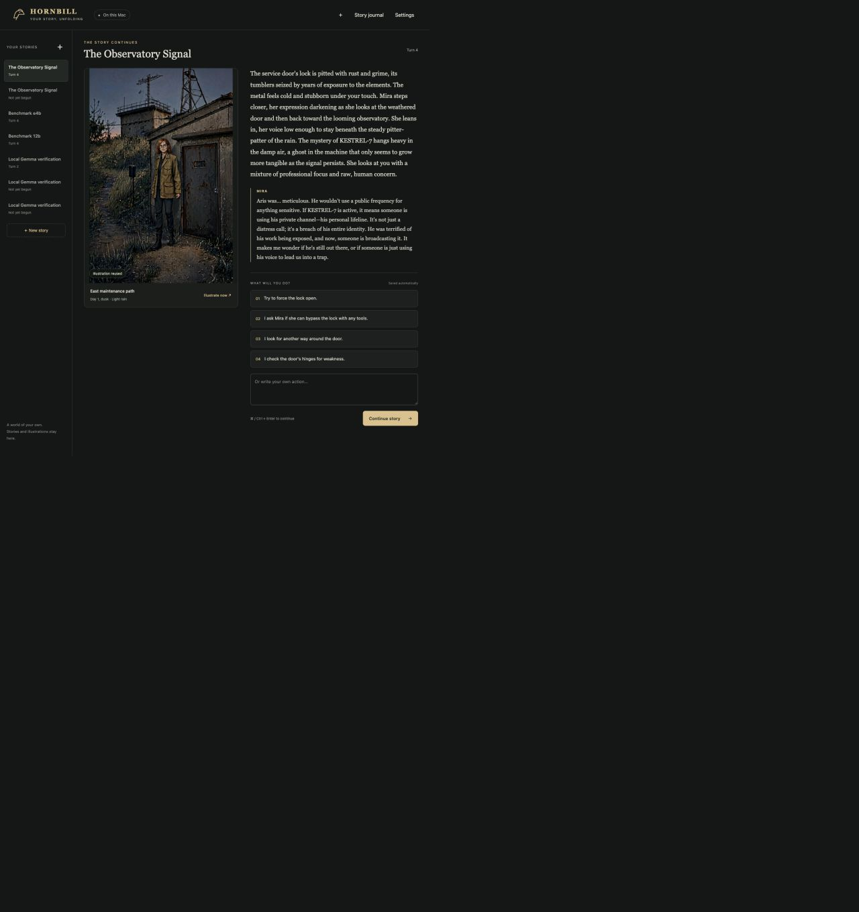

# Hornbill

Hornbill is a local illustrated interactive-story app for Apple Silicon Macs. You type an action or pick a choice, read the next scene, and get an illustration of it. Rust and SQLite own the story state; the story model and image model run as separate workers, one at a time, with no cloud inference.



## Requirements

- Apple Silicon Mac with Metal (tested on Apple Silicon only)
- macOS command-line tools (`xcode-select --install`)
- Internet during setup only; play is offline
- About 45–50 GB of disk for all models, environments and build files
- Keep the project and its runtime fully downloaded. In an iCloud-managed folder, use **Keep Downloaded** or install elsewhere.

## Install

```sh
git clone https://github.com/delirious6423/Hornbill-Game.git
cd Hornbill-Game
./scripts/setup.sh            # Rust, uv, Python 3.12, story environment
./scripts/model.sh download 12b
./scripts/model.sh use 12b
./scripts/image.sh setup      # image environment
./scripts/image.sh download   # Z-Image + encoder (converts on disk)
./scripts/doctor.sh
./scripts/image.sh doctor
```

Optional:

```sh
./scripts/model.sh download e4b   # Gemma E4B (8-bit)
./scripts/gguf.sh setup           # GGUF fallback (llama.cpp + Gemma 12B Q4_K_M)
```

The runtime lives in `.local/` beside the source. Set `HORNBILL_RUNTIME=/path` before setup to use another location; the path is recorded in `.runtime-path`. Setup never edits your shell profile. Exact versions and model pins are in [docs/MODELS.md](docs/MODELS.md).

## Run

```sh
./hornbill ui
```

This builds if needed, starts a server on `127.0.0.1` and opens your browser. Keep the Terminal window open; press Control-C to stop. `./hornbill ui --no-open` prints the launch link instead. The link carries a session key; `data/ui-session.json` (mode 0600) holds it, so keep it private.

## Using the app

- **New story** asks for a title and an optional **Premise**. The default start is Hornbill Observatory with Alex and Mira.
- Pick a choice or type an action. Command-Enter or Control-Enter submits. Each accepted turn is saved automatically; select a story under **Your stories** to resume it.
- **Cancel** stops the running worker. A scene already saved stays saved.
- **Illustrate scene** makes another illustration of the current scene.
- **Settings**: story model (Gemma 12B (Q6), Gemma E4B (8-bit), GGUF fallback), when to illustrate (at visual moments, every turn, only when I ask), illustration size (384×576, 512×768, 768×768) and seed. Settings are per story.
- **Story journal** shows the summary, inventory and open threads, and holds the story direction (tone, pacing), world notes (separate notes with a blank line; up to four relevant notes join each turn) and a reference image for a character or place. It also downloads the story and generation record as JSON.

Limits to know about:

- Narrative consistency is probabilistic. Validation protects saved state, not the truth of every sentence.
- A reference image guides composition and clothing, not exact faces.
- To change the starting characters and places, edit a copy of `prompts/world.json` and use `new --world`.

## CLI quick reference

`--save <name>` (default `main`) selects the story; `--data-dir` (env `HORNBILL_DATA_DIR`, default `data`) selects the data folder. Both go before or after the subcommand.

| Command | What it does |
|---|---|
| `./hornbill ui [--port N] [--no-open]` | Open the interface |
| `./hornbill --save S new [--title T] [--premise P] [--world FILE]` | Create a story (never overwrites) |
| `./hornbill --save S play` | Interactive text play; `/state`, `/help`, `/quit` |
| `./hornbill --save S turn --action 'text'` | Generate and save one turn |
| `./hornbill --save S illustrate [--width 512 --height 768 --steps 9 --seed 42]` | Illustrate the current scene |
| `./hornbill --save S inspect` | Print saved state as JSON |
| `./hornbill --save S export --output FILE` | Export state, prompts, attempts, metrics |
| `./hornbill schema` | Print the story model output schema |

`play` and `turn` accept `--backend mlx|gguf|demo` (default `mlx`), `--model PATH`, `--python`, `--llama-binary`, `--cpu` (GGUF only), `--timeout-seconds 360`, `--retries 1`, `--max-tokens 1536`, `--context-tokens 6144` (2048–8192), `--temperature 0.6`, `--seed 42` and `--memory-gib 10`. CLI turns do not illustrate on their own.

```sh
./hornbill --save demo new
./hornbill --save demo play --backend demo      # scripted, no model needed
./hornbill --save trip play --backend gguf --model "$(./scripts/gguf.sh path)"
```

Helper scripts: `model.sh download|use|path 12b|e4b`, `gguf.sh setup|binary|model|path`, `image.sh setup|download|doctor`, `doctor.sh`, `verify-local.sh`, `benchmark.sh`, `check.sh`.

## Project layout

```text
src/                 Rust: story engine, SQLite, local server, image prompt, process supervisor
ui/                  HTML, CSS and JavaScript, embedded in the binary
workers/gemma/       MLX story worker, model installer, pinned profiles
workers/gguf/        llama.cpp fallback worker and installer
workers/z_image/     Z-Image worker, encoder converter, pinned manifest
workers/tests/       Python protocol and manifest tests
prompts/             Starting world, story instructions, SQL migrations
scripts/             Setup, checks, diagnostics, benchmark
tests/               Rust integration tests
docs/                Architecture, models, performance
data/                Local database, illustrations, reference images (not in git)
```

## Development checks

```sh
./scripts/check.sh        # rustfmt, clippy -D warnings, cargo test, Python unit tests
./scripts/verify-local.sh # real two-turn run and export; needs models, takes minutes
```

The UI files are embedded at compile time: rebuild after editing them.

## Docs

- [Architecture](docs/ARCHITECTURE.md): turn flow, state, workers, data on disk
- [Models](docs/MODELS.md): profiles, pins, licenses, runtimes
- [Performance](docs/PERFORMANCE.md): measurements, benchmark, known limits
- [AGENTS.md](AGENTS.md): guide for contributors and coding agents
